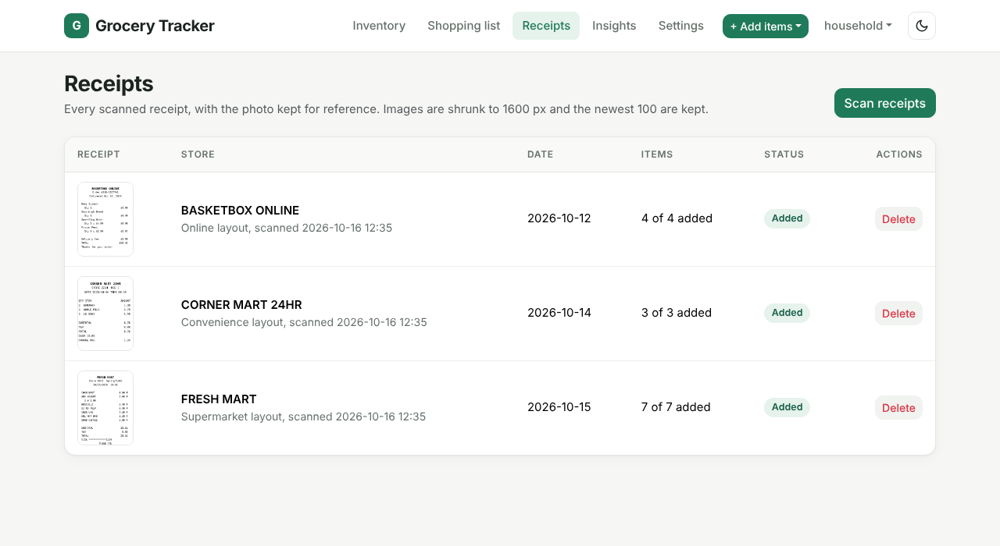
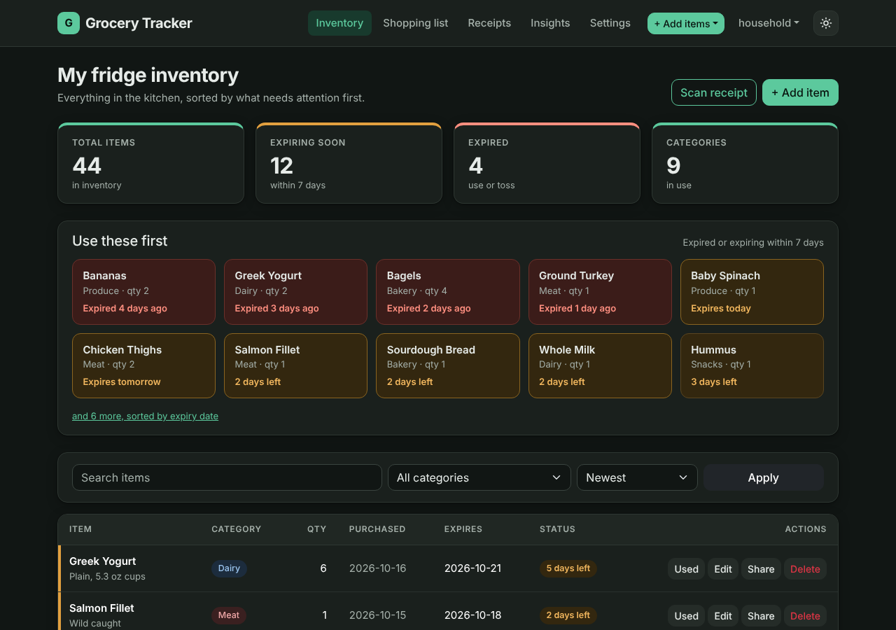
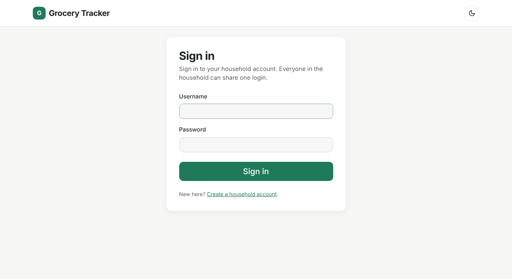
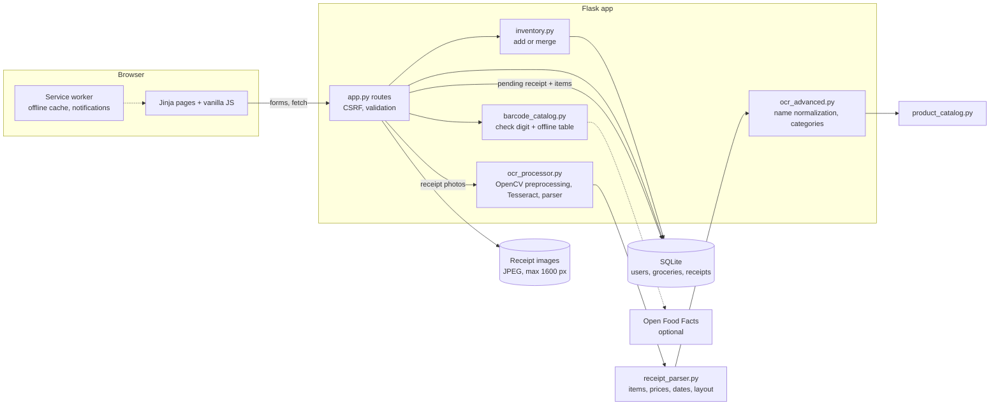

# Grocery Inventory Tracker

[](https://github.com/deokhwajeong/grocery-inventory-tracker/actions/workflows/ci.yml)
[](.github/workflows/ci.yml)
[](LICENSE)

A Flask and SQLite web app for keeping track of what is in the fridge and pantry. Add groceries by hand or by photographing receipts, one or a batch at a time (Tesseract OCR reads items, prices, quantities and the purchase date, you review them before saving), and the dashboard surfaces what is expired or about to expire so it gets used first. Each household has its own account, and the app has a dark mode. I built it as my final project for HarvardX CS50 (Introduction to Computer Science) to solve a small everyday problem: losing track of what we already have, buying duplicates, and throwing food away.


| Batch receipt upload | Review with the stored receipt image |
| --- | --- |
|  |  |

| Receipt history | Dark mode |
| --- | --- |
|  |  |

| Expiry warnings | Barcode lookup |
| --- | --- |
|  |  |

| Insights | Household sign-in | Mobile (dark) |
| --- | --- | --- |
|  |  |  |

All screenshots come from the real app with synthetic data (`scripts/seed_demo_data.py` and the generated sample receipts); the review screen shows real Tesseract output.

## Live demo

**[Try it in your browser](https://deokhwajeong.github.io/demos/grocery/)**, no install or sign-up needed.

The demo is a static build of this app for GitHub Pages. `scripts/build_demo.py` renders the real Jinja templates through Flask's test client against a seeded in-memory SQLite database (fictional items, dates relative to the build day), and a small script (`demo/demo.js`) stands in for the Flask routes by keeping the inventory in your browser's localStorage. Adding (including merging a duplicate into existing stock), editing, deleting, marking items as used, filtering, barcode lookups against the bundled catalog, the shopping list, insights, settings, CSV export, the dark mode toggle, and the receipt history all work. The receipt step comes with three generated sample receipts (supermarket, convenience store, online order) whose OCR results were computed at build time: scan one, or press "Load all 3 sample receipts" to watch a batch go through one file at a time, then review the items next to each receipt image. The sign-in and registration pages are included too and accept anything, since the demo has no server. Nothing you enter leaves your browser, and "Reset demo data" in the banner restores the sample inventory.

To build it yourself:

```bash
python scripts/build_demo.py           # writes demo-dist/ (gitignored)
python -m http.server -d demo-dist     # open http://127.0.0.1:8000
```

## Features

- **Inventory CRUD.** Add, edit, and delete items with name, quantity, category (9 built-in), purchase date, expiry date, and notes. A "Used" button takes one off the quantity and removes the item when the last one is used. Server-side validation rejects bad quantities, malformed dates, and expiry dates before the purchase date.
- **Household accounts.** Each household registers a username and password (stored as a salted scrypt hash via Werkzeug, never as text) and gets its own inventory, receipts, shopping list, and insights. Every query filters on the signed-in account, so one household can never read, edit, merge into, export, or reset another's data. Sign-in rotates the session, sign-out is a CSRF-protected POST, and redirects after sign-in only go to paths on the same site. The first account created on an existing database claims the items saved before accounts existed.
- **No duplicate rows.** Adding something that is already in stock (same name ignoring case, spacing, and plurals; same category; expiry dates within 3 days) adds to that item's quantity instead of creating a second row, both from the add form and from the receipt review. A different expiry date, such as a fresh carton next to last week's, stays a separate row so the expiry warnings stay accurate. A "Keep as a separate item" checkbox opts out.
- **Expiry tracking.** Each item is marked fresh, expiring soon, or expired. A "Use these first" panel lists expired items and items expiring within the warning window (7 days by default, adjustable on the Settings page).
- **Receipt scanning with OCR.** Upload or photograph a receipt. OpenCV rescales the photo so letters are a size Tesseract reads well, deskews it and binarizes it; Tesseract extracts the text; and the parser in `receipt_parser.py` reads item lines, line totals and unit prices, quantities (`2 @ 1.99` lines, `2x`, `x2`, a QTY column, `Qty 2 x $1.99`), weighed produce (`1.42 lb @ 0.69 /lb`), savings and coupon lines (kept as a discount on the item, not as an item), and the purchase date in seven formats. It also detects the receipt layout (supermarket, convenience store, warehouse club, online order) and reads each one the way it is printed. Nothing is saved until you confirm on the review screen.
- **Batch scanning.** Pick up to 10 receipt photos at once. The page sends them one at a time and shows per-file status and overall progress ("2 of 5"), then opens a single review with every receipt's items grouped under its image. Files that fail are reported without losing the others. Without JavaScript, the same multi-file form is processed on the server.
- **Receipt images kept for reference.** Each scanned receipt is stored with its parsed items, store, layout, and date. The image is re-encoded as a JPEG of at most 1600 px (EXIF orientation applied, metadata dropped), only the newest 100 per household are kept, and images are served only to their owner. The review screen shows each image next to its items, the Receipts page lists every scan with its import status, and items added from a receipt link back to it. Image storage can be turned off with `STORE_RECEIPT_IMAGES=false`.
- **Product catalog with 558 products.** Receipt shorthand such as `ORG BNNA`, `KS WHL MLK 1GAL`, `BNLS SKLS CHKN BRST` or `COCA COLA` is normalized to "Bananas", "Whole Milk", "Chicken Breast" and "Coca-Cola" with the right category. `product_catalog.py` is a hand-written list of everyday grocery products (with spelling and brand variants and the romanized Korean names the app already knew), a table of common receipt abbreviations, word-order-insensitive matching, prefix matching for truncated words, and fuzzy matching for OCR damage. The review screen shows how each name was printed.
- **Barcode lookup.** Codes are checked with the GS1 check digit and looked up in a small offline catalog (`barcode_catalog.py`) that uses store-internal UPC prefixes, so it cannot clash with real products. Setting `BARCODE_ONLINE_LOOKUP=true` also looks unknown codes up on Open Food Facts (open data, 4 second timeout, results cached); when that is off, slow, or offline, the page says so and opens the add form for manual entry. The camera scanner uses ZXing for 1D and 2D codes.
- **Dark mode.** Follows the system setting by default; the navbar toggle overrides it and is remembered. The theme is applied before the page paints, so there is no flash. `scripts/check_contrast.py` checks the main text and button colors of both themes against WCAG AA (4.5:1), and CI runs it.
- **Search, filter, and sort** by name, category, purchase date, expiry date, or quantity.
- **Shopping list suggestions** from low-stock items, items that expired in the last week, and repeat purchases. The list itself is stored in the browser.
- **Insights page** with category distribution, monthly purchase counts, expired items by category, and average shelf life.
- **CSV export**, a one-click "clear expired items" action, and a full reset (of your own household's data) on the Settings page.
- **Installable PWA.** Web app manifest plus a service worker that serves static assets from cache and falls back to the last loaded pages when offline. Signing out clears those cached pages. With permission, the open app shows browser notifications for items expiring today or tomorrow.
- **Security basics.** CSRF tokens on every form and on the JSON POST endpoints (Flask-WTF), uploads limited by size (16 MB, configurable) and checked to be a decodable image rather than trusting the extension, Jinja autoescaping, and parameterized SQL throughout. Error responses never echo exception text.
- **Graceful OCR fallback.** If Tesseract is not installed the app still runs, and the scan page explains how to enable OCR. Missing language packs (for example Korean) are skipped automatically.

## Receipt OCR accuracy

Real receipts cannot be committed (card digits, locations, shopping habits), so `scripts/receipt_dataset.py` generates a reproducible synthetic dataset: 60 receipts and 395 items across the four layouts, seven date formats, till-style abbreviated names, and photo-like noise (slight rotation, blur, uneven lighting, JPEG artifacts). The ground truth is committed in `datasets/receipts/ground_truth.json`; the images are regenerated on demand. `scripts/ocr_accuracy.py` scores the app against it, either on the exact receipt text (parser only) or on the images (the full OCR pipeline). CI prints the OCR report on every run, and the test suite has accuracy gates.

```bash
python scripts/receipt_dataset.py              # writes datasets/receipts/ (images are gitignored)
python scripts/ocr_accuracy.py --mode ocr      # or --mode text, add -v for one line per receipt
```

Results on this dataset, measured on a 4-core Linux container with Tesseract 5.3.4. "Before" is the pipeline as it was before this work, run through the same script:

| Full pipeline on the images | Before | After |
| --- | --- | --- |
| Item recall (receipt items found) | 45.8% | 92.9% |
| Item precision (parsed rows that are real items) | 39.3% | 96.3% |
| Price correct (matched items) | 67.4% | 98.4% |
| Quantity correct (matched items) | 50.8% | 98.6% |
| Name normalized to the product name | 15.5% | 99.5% |
| Purchase date correct | 35.0% | 98.3% |
| Receipt layout detected | 26.7% | 100% |
| Seconds per receipt, mean / median / p95 / max | 11.4 / 8.72 / 13.7 / 149 | 0.44 / 0.42 / 0.61 / 0.72 |

By layout, after: convenience 100% recall, warehouse 96.1%, supermarket 95.8%, online orders 81.4% (the weakest: Tesseract sometimes merges the two-line "name / Qty" blocks). On the exact receipt text the parser scores 100% on every metric except name normalization (99.5%).

Read these numbers with care:

- The parser and the normalizer were developed against this generator, so the text-mode results show coverage of these four layouts, not accuracy on receipts in the wild. The generator's abbreviation table and the catalog's were written separately, but both describe common till shorthand. The OCR numbers are the more meaningful ones, and real, crumpled, thermal-paper photos will score lower.
- The "before" layout figure is partly a labelling difference: the old detector returned store chain names rather than layouts.
- Speed: the old pipeline ran 20 Tesseract passes per image plus non-local-means denoising. The new one makes one pass when the result already looks like a receipt (every receipt in this dataset), and otherwise runs three fallback passes in parallel. On phone-sized images (the same receipts enlarged 3 to 4 times) the old pipeline did not finish a single receipt in 10 minutes here, because Tesseract slows down sharply on very large glyphs; the new pipeline first scales the image so capital letters are about 28 px tall and read those 20 receipts in 0.46 s on average (0.72 s max) with 92.0% recall. Each Tesseract call also has a 20 second timeout.

## Quickstart

Requirements: Python 3.12 (the version CI tests). Tesseract is optional and only needed for receipt scanning.

```bash
git clone https://github.com/deokhwajeong/grocery-inventory-tracker.git
cd grocery-inventory-tracker
python3 -m venv .venv
source .venv/bin/activate          # Windows: .venv\Scripts\activate
pip install -r requirements.txt

python scripts/seed_demo_data.py   # optional: load synthetic demo items
flask --app app run                # open http://127.0.0.1:5000
```

Create a household account on the sign-in page, or sign in as `demo` / `demo-password` if you ran the seed script. The SQLite database (`groceries.db`) and its tables are created automatically on first start, and older databases are migrated in place. `python app.py` also works and reads host, port, and debug settings from `.env` (see `.env.example`).

To enable receipt scanning, install Tesseract:

```bash
sudo apt-get install tesseract-ocr     # Debian/Ubuntu (add tesseract-ocr-kor for Korean receipts)
brew install tesseract                 # macOS
```

### Run the tests

```bash
pip install -r requirements-dev.txt
ruff check .
pytest --cov          # fails below 80% line coverage
```

The suite (239 tests) covers the routes, validation, expiry logic, duplicate merging, accounts and per-household isolation, CSRF and upload checks, receipt image storage and batch upload, the barcode lookup (online lookup with a mocked network), database failure handling, date formats, price and quantity extraction, layout detection, product normalization, the dark mode contrast, and accuracy gates on the synthetic receipt dataset. The OCR tests render receipt images and run real Tesseract on them; they are skipped when Tesseract is not installed. GitHub Actions runs lint, the tests, the OCR accuracy report and the contrast check with Tesseract installed on every push, and fails the build if line coverage drops below 80% (currently about 93%).

### Docker

```bash
export SECRET_KEY=$(python3 -c "import secrets; print(secrets.token_hex(32))")
docker compose up --build              # http://localhost:5000, data persists in ./data
```

The image includes Tesseract with English and Korean language packs and serves the app with gunicorn. `FLASK_ENV=production` requires `SECRET_KEY` to be set.

## Tech stack

| Layer | Tools |
| --- | --- |
| Backend | Python 3.12, Flask 3, SQLite (`sqlite3`), gunicorn |
| OCR | Tesseract via `pytesseract`, OpenCV and NumPy for preprocessing, `fuzzywuzzy` for name matching, a curated product catalog |
| Frontend | Jinja templates, Bootstrap 5.3 (vendored in `static/vendor/`), a small custom theme, vanilla JavaScript |
| PWA | Web app manifest, service worker, Notifications API |
| Security | Werkzeug password hashing, Flask-WTF CSRF protection, Pillow image verification |
| Quality | pytest, pytest-cov (80% gate), ruff, a synthetic OCR benchmark, a WCAG contrast check, GitHub Actions |

## Project layout

```
app.py                 Flask routes: accounts, inventory, receipt upload/review/history, shopping list, insights, settings, JSON/CSV endpoints
config.py              Settings loaded from environment variables (.env supported)
schema.sql             SQLite schema (users, groceries, receipts) and indexes
inventory.py           Add-or-merge logic shared by the add form and the receipt review
receipt_store.py       Receipt records, stored images (downscaling, pruning, deletion)
barcode_catalog.py     GS1 check digit validation, the offline catalog, the optional Open Food Facts lookup
ocr_processor.py       Image rescaling and preprocessing, Tesseract passes, the parse pipeline
receipt_parser.py      Receipt text parsing: items, prices, quantities, discounts, dates, layout detection
ocr_advanced.py        Name normalization, duplicate merging, quality checks, category suggestions
product_catalog.py     558 curated grocery products, receipt abbreviations, matching
datasets/receipts/     Ground truth of the synthetic receipt dataset (images are generated)
scripts/
  seed_demo_data.py    Loads synthetic demo items (into a "demo" account) with dates relative to today
  build_demo.py        Builds the static GitHub Pages demo into demo-dist/
  receipt_dataset.py   Generates the synthetic receipt dataset
  ocr_accuracy.py      Scores the parser or the full OCR pipeline against the dataset
  check_contrast.py    WCAG contrast check for the light and dark themes
demo/                  Browser-side data layer and banner styles for the static demo
templates/             Jinja templates (layout.html is the shared shell)
static/
  styles.css           App theme (light and dark) on top of Bootstrap
  theme.js             Dark mode toggle
  camera-handler.js    Camera and file picker helper for the receipt page
  service-worker.js    PWA caching and notifications
  manifest.json, icons/
  vendor/bootstrap/    Bootstrap 5.3.3 CSS and JS bundle (MIT)
tests/                 pytest suite
docs/screenshots/      Images used in this README
Dockerfile, docker-compose.yml, Procfile, Aptfile, runtime.txt   Deployment configs
```

## Architecture



Each receipt goes through `/ocr` or, one file at a time from the batch view, `/api/ocr/scan` (image check, OCR, parse). The parsed items wait in the receipts table with status "pending" (a batch of receipts would not fit in a session cookie), the image is stored next to it, and nothing reaches the inventory until the user confirms on `/ocr/review`. Both that path and the manual add form write through `inventory.add_or_merge()`, so the duplicate rules live in one place. The static demo reuses the same templates and mirrors the server rules in `demo/demo.js`.

## Design decisions

- **Review before save.** OCR output is stored as a pending receipt and shown on an editable review table, so a misread receipt never pollutes the inventory.
- **Measure OCR on data that can be published.** A generated dataset with exact ground truth makes accuracy and speed changes measurable and repeatable in CI without committing anyone's receipts. Its limits are stated next to the numbers.
- **Attach quantity lines by arithmetic.** A `2 @ 1.99` line is attached to whichever neighbouring item costs 3.98, so the same rule works whether the till prints it above the item (warehouse clubs) or below it (supermarkets), and survives OCR dropping a line.
- **Accounts without new dependencies.** Session-based sign-in with Werkzeug's password hashing keeps the CS50-sized stack (no Flask-Login or ORM), and a single `user_id` filter on every query is easy to audit; a test checks that another household's items cannot be read, edited, merged into, or reset.
- **Merge on add, but only when it is safe.** One row per product makes the quantity and the "Used" button meaningful. Matching needs the same normalized name and category, and expiry dates within a few days of each other; otherwise a new purchase would hide the older units' expiry date. On a merge the earlier expiry date is kept so the warning fires for the oldest units. Exact normalized matching was chosen over fuzzy matching here because a wrong merge silently changes someone's stock, while a missed merge is visible and easy to fix.
- **An honest barcode feature instead of a fake one.** The lookup used to return a made-up name for any code. It validates the check digit, answers from a small bundled catalog of store-internal codes, and only asks Open Food Facts when the operator turns that on. Offline is the default so the app works without internet access and does not send barcodes anywhere unless asked to.
- **Local OCR instead of a cloud API.** Tesseract is free and keeps receipt images on the server. The original upload is deleted after processing; only a downscaled copy is kept, and only if image storage is on.
- **SQLite over a database server.** Zero setup for a single household; indexes on `category` and `expiry_date` keep filtering fast.
- **Assets vendored, not loaded from a CDN.** The UI renders the same offline, behind restrictive networks, and in the PWA. The one exception is the optional camera barcode scanner, which loads a pinned ZXing build.
- **A coverage gate, not a coverage target.** CI fails below 80% so coverage cannot quietly slide; the number is a floor, and the tests are written around behaviour (merging rules, CSRF, failure handling) rather than lines.

## Known limitations and roadmap

- OCR accuracy is measured on synthetic receipts only (see above). Crumpled or faded thermal paper, and layouts unlike the four supported ones, will need more fixes on the review screen. Online order summaries are the weakest layout.
- Expiry dates are not inferred from receipts; they are entered on the review screen or the edit form. Suggesting default shelf lives per category is a natural next step.
- One login per household: there are no per-person accounts, password resets, or sign-in rate limiting yet.
- The camera scanner loads ZXing from a CDN, so it needs a network connection; manual barcode entry works offline.
- Duplicate merging uses exact matching on normalized names, so spelling variants such as "OJ" and "Orange Juice" stay separate when typed by hand (receipt names are normalized first). Merges are not undoable except by editing the item.
- Notifications only fire while the app is open; there is no server-side push.
- The "consumed" state is not modeled, so the insights treat every item that has not expired as still in use.

Closed roadmap issues and the reasons for the ones that were not done are in [ROADMAP.md](ROADMAP.md).

## Author

Deokhwa Jeong. HarvardX CS50 final project.

## License

[MIT](LICENSE)
