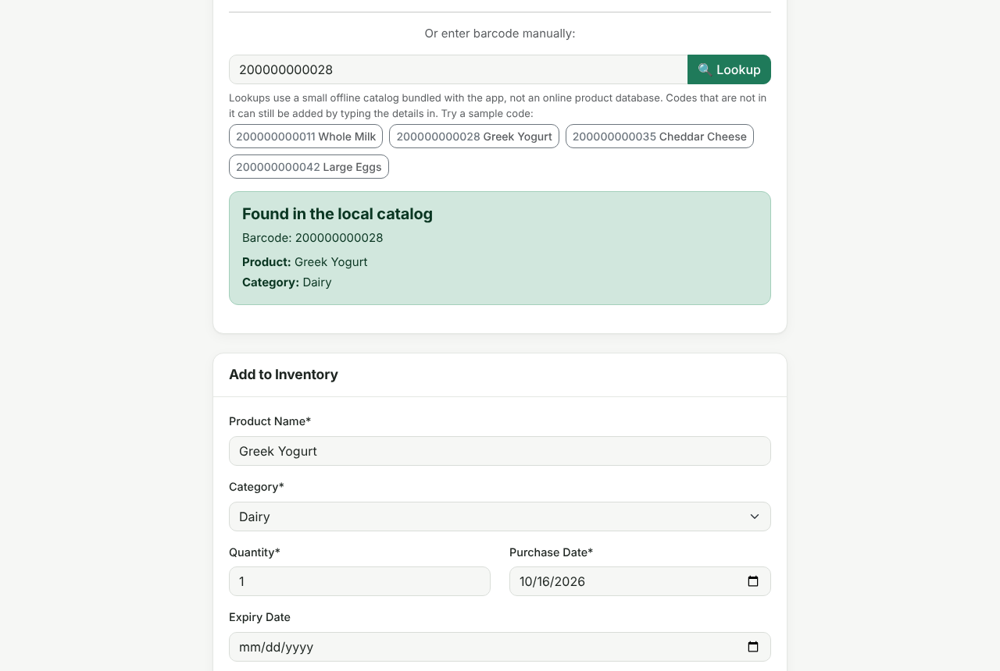
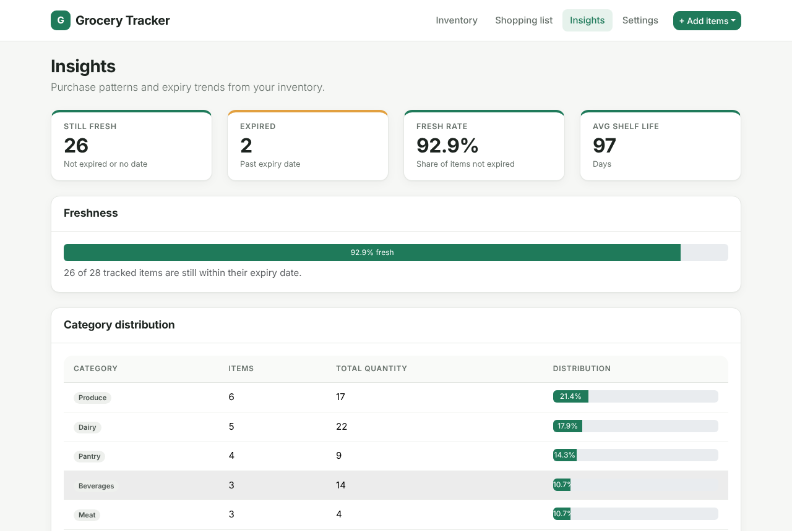
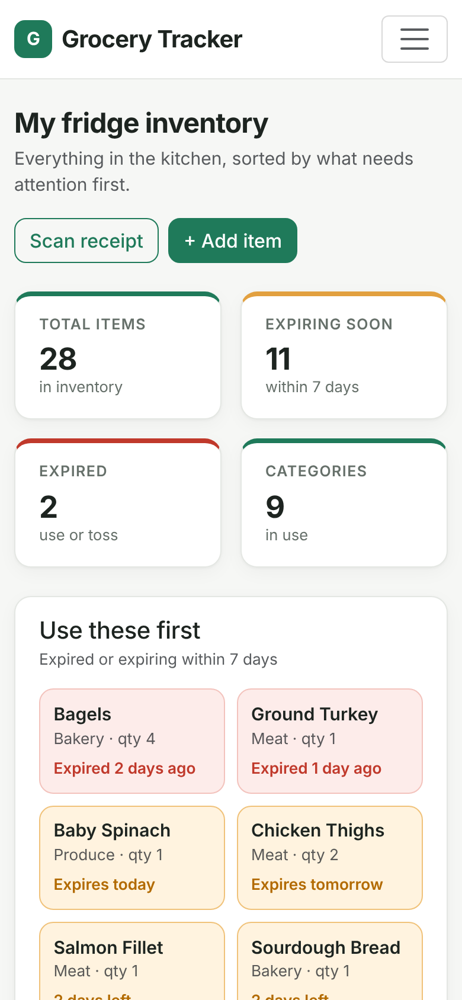
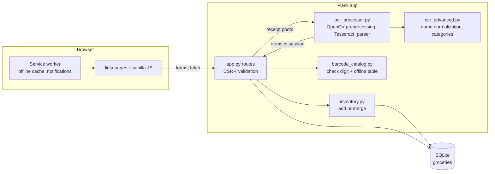

# Grocery Inventory Tracker

[](https://github.com/deokhwajeong/grocery-inventory-tracker/actions/workflows/ci.yml)
[](.github/workflows/ci.yml)
[](LICENSE)

A Flask and SQLite web app for keeping track of what is in the fridge and pantry. Add groceries by hand or by photographing a receipt (Tesseract OCR reads the line items, you review them before saving), and the dashboard surfaces what is expired or about to expire so it gets used first. I built it as my final project for HarvardX CS50 (Introduction to Computer Science) to solve a small everyday problem: losing track of what we already have, buying duplicates, and throwing food away.


| Expiry warnings | Receipt OCR review |
| --- | --- |
|  |  |

| Receipt upload | Barcode lookup (offline catalog) |
| --- | --- |
|  |  |

| Insights | Mobile |
| --- | --- |
|  |  |

All screenshots use synthetic demo data from `scripts/seed_demo_data.py`.

## Live demo

**[Try it in your browser](https://deokhwajeong.github.io/demos/grocery/)**, no install or sign-up needed.

The demo is a static build of this app for GitHub Pages. `scripts/build_demo.py` renders the real Jinja templates through Flask's test client against a seeded in-memory SQLite database (fictional items, dates relative to the build day), and a small script (`demo/demo.js`) stands in for the Flask routes by keeping the inventory in your browser's localStorage. Adding (including merging a duplicate into existing stock), editing, deleting, marking items as used, filtering, barcode lookups against the bundled catalog, the shopping list, insights, settings, and CSV export all work. The receipt step loads a generated sample receipt whose OCR results were computed at build time, so you can try the review screen without a server. Nothing you enter leaves your browser, and "Reset demo data" in the banner restores the sample inventory.

To build it yourself:

```bash
python scripts/build_demo.py           # writes demo-dist/ (gitignored)
python -m http.server -d demo-dist     # open http://127.0.0.1:8000
```

## Features

- **Inventory CRUD.** Add, edit, and delete items with name, quantity, category (9 built-in), purchase date, expiry date, and notes. A "Used" button takes one off the quantity and removes the item when the last one is used. Server-side validation rejects bad quantities, malformed dates, and expiry dates before the purchase date.
- **No duplicate rows.** Adding something that is already in stock (same name ignoring case, spacing, and plurals; same category; expiry dates within 3 days) adds to that item's quantity instead of creating a second row, both from the add form and from the receipt review. A different expiry date, such as a fresh carton next to last week's, stays a separate row so the expiry warnings stay accurate. A "Keep as a separate item" checkbox opts out.
- **Expiry tracking.** Each item is marked fresh, expiring soon, or expired. A "Use these first" panel lists expired items and items expiring within the warning window (7 days by default, adjustable to 3 or 14 on the Settings page).
- **Receipt scanning with OCR.** Upload or photograph a receipt. OpenCV preprocesses the image (deskew, contrast, thresholding, denoising), Tesseract extracts text, and a parser pulls out item lines, quantities such as `2x`, prices, and the purchase date while skipping totals, tax, and payment lines. Names are normalized against a small product dictionary and given a suggested category. Nothing is saved until you confirm on the review screen.
- **Barcode lookup, honestly scoped.** Codes are checked with the GS1 check digit and looked up in a small offline catalog (`barcode_catalog.py`) that uses store-internal UPC prefixes, so it cannot clash with real products. Unknown codes say so and the add form opens for manual entry. There is no online product database behind it.
- **Search, filter, and sort** by name, category, purchase date, expiry date, or quantity.
- **Shopping list suggestions** from low-stock items, items that expired in the last week, and repeat purchases. The list itself is stored in the browser.
- **Insights page** with category distribution, monthly purchase counts, expired items by category, and average shelf life.
- **CSV export**, a one-click "clear expired items" action, and a full reset on the Settings page.
- **Installable PWA.** Web app manifest plus a service worker that serves static assets from cache and falls back to the last loaded pages when offline. With permission, the open app shows browser notifications for items expiring today or tomorrow.
- **Security basics.** CSRF tokens on every form and on the JSON POST endpoints (Flask-WTF), uploads limited by size (16 MB, configurable) and checked to be a decodable image rather than trusting the extension, Jinja autoescaping, and parameterized SQL throughout. Error responses never echo exception text.
- **Graceful OCR fallback.** If Tesseract is not installed the app still runs, and the scan page explains how to enable OCR. Missing language packs (for example Korean) are skipped automatically.

## Quickstart

Requirements: Python 3.12 (the version CI tests). Tesseract is optional and only needed for receipt scanning.

```bash
git clone https://github.com/deokhwajeong/grocery-inventory-tracker.git
cd grocery-inventory-tracker
python3 -m venv .venv
source .venv/bin/activate          # Windows: .venv\Scripts\activate
pip install -r requirements.txt

python scripts/seed_demo_data.py   # optional: load synthetic demo items
flask --app app run                # open http://127.0.0.1:5000
```

The SQLite database (`groceries.db`) and its tables are created automatically on first start. `python app.py` also works and reads host, port, and debug settings from `.env` (see `.env.example`).

To enable receipt scanning, install Tesseract:

```bash
sudo apt-get install tesseract-ocr     # Debian/Ubuntu (add tesseract-ocr-kor for Korean receipts)
brew install tesseract                 # macOS
```

### Run the tests

```bash
pip install -r requirements-dev.txt
ruff check .
pytest --cov          # fails below 80% line coverage
```

The suite (80 tests) covers the routes, validation, expiry logic, duplicate merging, CSRF and upload checks, barcode lookup, database failure handling, the OCR review flow, the no-Tesseract fallback, and receipt parsing. One end-to-end test renders a synthetic receipt image and runs real OCR on it; it is skipped when Tesseract is not installed. GitHub Actions runs lint and the tests with Tesseract installed on every push, and fails the build if line coverage drops below 80% (currently about 84%).

### Docker

```bash
export SECRET_KEY=$(python3 -c "import secrets; print(secrets.token_hex(32))")
docker compose up --build              # http://localhost:5000, data persists in ./data
```

The image includes Tesseract with English and Korean language packs and serves the app with gunicorn. `FLASK_ENV=production` requires `SECRET_KEY` to be set.

## Tech stack

| Layer | Tools |
| --- | --- |
| Backend | Python 3.12, Flask 3, SQLite (`sqlite3`), gunicorn |
| OCR | Tesseract via `pytesseract`, OpenCV and NumPy for preprocessing, `fuzzywuzzy` for name matching |
| Frontend | Jinja templates, Bootstrap 5.3 (vendored in `static/vendor/`), a small custom theme, vanilla JavaScript |
| PWA | Web app manifest, service worker, Notifications API |
| Security | Flask-WTF CSRF protection, Pillow image verification |
| Quality | pytest, pytest-cov (80% gate), ruff, GitHub Actions |

## Project layout

```
app.py                 Flask routes: inventory, OCR upload/review, shopping list, insights, settings, JSON/CSV endpoints
config.py              Settings loaded from environment variables (.env supported)
schema.sql             SQLite schema (groceries table and indexes)
inventory.py           Add-or-merge logic shared by the add form and the receipt review
barcode_catalog.py     GS1 check digit validation and the offline barcode catalog
ocr_processor.py       Image preprocessing, Tesseract calls, receipt text parsing
ocr_advanced.py        Product name normalization, duplicate merging, category suggestions
scripts/
  seed_demo_data.py    Loads synthetic demo items with dates relative to today
  build_demo.py        Builds the static GitHub Pages demo into demo-dist/
demo/                  Browser-side data layer and banner styles for the static demo
templates/             Jinja templates (layout.html is the shared shell)
static/
  styles.css           App theme on top of Bootstrap
  camera-handler.js    Camera and file picker helper for the receipt page
  service-worker.js    PWA caching and notifications
  manifest.json, icons/
  vendor/bootstrap/    Bootstrap 5.3.3 CSS and JS bundle (MIT)
tests/                 pytest suite
docs/screenshots/      Images used in this README
Dockerfile, docker-compose.yml, Procfile, Aptfile, runtime.txt   Deployment configs
```

## Architecture



A receipt goes through `/ocr` (upload, image check, OCR, parse), lands in the session, and is only written to SQLite after the user confirms it on `/ocr/review`. Both that path and the manual add form write through `inventory.add_or_merge()`, so the duplicate rules live in one place. The static demo reuses the same templates and mirrors the server rules in `demo/demo.js`.

## Design decisions

- **Review before save.** OCR output goes into the session and onto an editable review table, so a misread receipt never pollutes the inventory.
- **Merge on add, but only when it is safe.** One row per product makes the quantity and the "Used" button meaningful. Matching needs the same normalized name and category, and expiry dates within a few days of each other; otherwise a new purchase would hide the older units' expiry date. On a merge the earlier expiry date is kept so the warning fires for the oldest units. Exact normalized matching was chosen over fuzzy matching here because a wrong merge silently changes someone's stock, while a missed merge is visible and easy to fix.
- **An honest barcode feature instead of a fake one.** The lookup used to return a made-up name for any code. It now validates the check digit and answers only from a small bundled catalog of store-internal codes, and says clearly when a code is unknown. Keeping the response shape (`found`, `name`, `category`, `source`) means an Open Food Facts client can replace the catalog later without touching the page.
- **Local OCR instead of a cloud API.** Tesseract is free and keeps receipt images on the server; uploads are deleted right after processing.
- **SQLite over a database server.** Zero setup for a single household; indexes on `category` and `expiry_date` keep filtering fast.
- **Assets vendored, not loaded from a CDN.** The UI renders the same offline, behind restrictive networks, and in the PWA. The one exception is the optional camera barcode scanner, which loads a pinned ZXing build.
- **A coverage gate, not a coverage target.** CI fails below 80% so coverage cannot quietly slide; the number is a floor, and the tests are written around behaviour (merging rules, CSRF, failure handling) rather than lines.

## Known limitations and roadmap

- Single household, no user accounts or authentication. Anyone who can reach the server can edit the data, so run it locally or behind your own auth.
- OCR works well on clean, printed receipts with one item per line. Crumpled photos, unusual layouts, and abbreviated product codes still need manual fixes on the review screen. Accuracy has not been benchmarked on a real receipt dataset yet.
- Expiry dates are not inferred from receipts; they are entered on the review screen or the edit form. Suggesting default shelf lives per category is a natural next step.
- Barcode lookups only know the codes in the bundled catalog; there is no online product database yet (Open Food Facts is the planned source). The camera scanner loads ZXing from a CDN, so it needs a network connection.
- Duplicate merging uses exact matching on normalized names, so spelling variants such as "OJ" and "Orange Juice" stay separate. Merges are not undoable except by editing the item.
- Notifications only fire while the app is open; there is no server-side push.
- The "consumed" state is not modeled, so the insights treat every item that has not expired as still in use.

## Author

Deokhwa Jeong. HarvardX CS50 final project.

## License

[MIT](LICENSE)
